**English** | [简体中文](./README.zh-CN.md)

<h1 align="center">Sideband</h1>

<p align="center">
  
</p>

<p align="center">
  <a href="./LICENSE"></a>
  
  
  
  <a href="https://github.com/SuperMarioYL/sideband/actions/workflows/ci.yml"></a>
</p>

<p align="center">
  <picture>
    <source media="(max-width: 620px) and (prefers-color-scheme: dark)" srcset="./assets/hero-mobile-dark.svg">
    <source media="(max-width: 620px)" srcset="./assets/hero-mobile-light.svg">
    <source media="(prefers-color-scheme: dark)" srcset="./assets/hero-dark.svg">
    
  </picture>
</p>

**Sandboxed coding agents still share one inference server, and that shared engine is a channel.** Sideband measures how many bits per session per second cross between two sessions that never touch the network — so an isolation boundary becomes a number you can re-run instead of a promise you have to believe.

It is a meter, not a compliance verdict. It prints a rate, a 95% bootstrap interval and a three-way verdict, writes a machine-readable `channel_budget.json` plus a one-page markdown, and stops there.

##  Why this exists

A sandbox decides what a coding agent may touch. It cuts files, processes and
outbound sockets. It does not cut the thing every agent session actually calls:
the inference server that sits on the trusted side of the boundary because the
agent needs it.

Continuous batching then does the rest. When several requests are in flight, the
engine schedules them into the same step, and the width of that batch changes
which kernel runs and how long each step takes. A session that can choose how
much work to keep in the batch can move another session's timings by a few
milliseconds. The receiver needs no socket, no shared file and no shared API
call — only its own latency measurements and a threshold agreed in advance.

Nothing in that story is new: continuous batching and prefix caching have been
default for years. What has been missing is a way to price it for a specific
engine build. "The sandbox isolates them" is a claim; `3.1 bits/session/s at
idle, 0.8 under load` is something you can re-run after a version bump and put
next to the previous run.

A `closed` verdict is a real answer, and often the useful one: it is evidence
that this build, at these loads, does not admit a measurable channel — and that
you may not need a second GPU.

##  How it works

<p align="center">
  <picture>
    <source media="(max-width: 620px) and (prefers-color-scheme: dark)" srcset="./assets/architecture-mobile-dark.svg">
    <source media="(max-width: 620px)" srcset="./assets/architecture-mobile-light.svg">
    <source media="(prefers-color-scheme: dark)" srcset="./assets/architecture-dark.svg">
    
  </picture>
</p>

One process, one external HTTP dependency you already run. `engine.py` touches
only the public surface (`GET /version`, `GET /v1/models`, `GET /metrics`, and
streaming `POST /v1/chat/completions`). `canary.py` encodes a bit as a decode-step
count and decodes it from the receiver's own inter-token latencies. `measure.py`
is the single statistics path; `replay.py` feeds a recorded trace into that same
function, so a replay cannot read rosier than the run that produced it.

<p align="center">
  <picture>
    <source media="(max-width: 620px) and (prefers-color-scheme: dark)" srcset="./assets/process-mobile-dark.svg">
    <source media="(max-width: 620px)" srcset="./assets/process-mobile-light.svg">
    <source media="(prefers-color-scheme: dark)" srcset="./assets/process-dark.svg">
    
  </picture>
</p>

Each round carries one bit. The sender occupies 4 decode steps for a `0` and 32
for a `1`; the receiver compares its mean step time to a midpoint threshold
calibrated on known-bit rounds. Throughput is correct-minus-wrong bits over the
wall-clock seconds they occupied. A shuffled-bit null must read near zero before
any point counts as signal.

##  Quickstart

Python 3.12. Replaying needs no engine and no GPU.

```bash
git clone https://github.com/SuperMarioYL/sideband.git
cd sideband
python3 -m venv .venv
source .venv/bin/activate
pip install -e .
sideband replay examples/trace-vllm-qwen05b.jsonl
```

That prints the three-point sweep in about a second and writes
`channel_budget.json` and `channel_budget.md` into the current directory. Or run
the packaged path, which also prints the one-page artifact:

```bash
bash scripts/demo.sh
```

Have a card? Serve a model that fits in 8 GB, then measure the engine you are
actually running:

```bash
vllm serve Qwen/Qwen2.5-0.5B-Instruct --max-num-seqs 8 --port 8000

sideband measure \
  --endpoint http://127.0.0.1:8000/v1 \
  --model Qwen/Qwen2.5-0.5B-Instruct \
  --seconds 60 \
  --declare-max-num-seqs 8 \
  --launch-cmd "vllm serve Qwen/Qwen2.5-0.5B-Instruct --max-num-seqs 8 --port 8000" \
  --trace-out run.jsonl
```

`--declare-max-num-seqs` exists because no production route reports scheduler
configuration. It must match the `--max-num-seqs` the engine was launched with,
or the number cannot be attributed to a build. `--trace-out` keeps the evidence
so the run can be replayed later. llama.cpp server and SGLang work too, as long
as they speak the OpenAI chat-completions API; fields the engine does not serve
are reported as not served rather than guessed.

To inspect an engine without running a sweep:

```bash
sideband fingerprint --endpoint http://127.0.0.1:8000/v1 --model Qwen/Qwen2.5-0.5B-Instruct
```

##  Demo

The recording is [assets/demo.cast](./assets/demo.cast) (asciinema 3.2.0,
~36 s); the GIF below was rendered from the same commands by
[assets/demo.tape](./assets/demo.tape). This is the actual stdout of
`bash scripts/demo.sh` on a laptop with no engine and no GPU, with trailing
padding spaces removed:

<p align="center">
  <a href="./assets/demo.cast"></a>
</p>

```console
$ bash scripts/demo.sh
# no SIDEBAND_ENDPOINT set: replaying a recorded trace, no engine and no GPU
Qwen/Qwen2.5-0.5B-Instruct on vllm 0.11.0
Provenance: replay — the probe rows were replayed from
examples/trace-vllm-qwen05b.jsonl. The trace is marked synthetic: its rows were
generated, not recorded from a running engine. The engine fingerprint below was
authored in the trace; nothing in this document was read back from /version,
/v1/models or /metrics.
load  bits/session/s     ci95  verdict
idle             3.1  2.8-3.3  open
0.5x             1.7  0.9-2.3
1.0x             0.8  0.0-1.6
verdict: open — 3.1 bits/session/s at idle (ci95 2.8-3.3) rises above the 1.4
bits/session/s shuffled-bits floor; 2 of 3 load points read open
vllm · authored: version=0.11.0, served_model=Qwen/Qwen2.5-0.5B-Instruct,
max_model_len=32768, prefix_caching=True · declared: max_num_seqs=8,
launch_cmd=vllm serve Qwen/Qwen2.5-0.5B-Instruct --max-num-seqs 8 --port 8000
wrote channel_budget.json and channel_budget.md
```

| load | bits/session/s | ci95 | verdict |
| --- | --- | --- | --- |
| idle | 3.1 | 2.8–3.3 | open |
| 0.5x | 1.7 | 0.9–2.3 | |
| 1.0x | 0.8 | 0.0–1.6 | |

That run covers 180 payload rounds with 40 decode errors and a shuffled-bit
null of 0.3 bits/session/s. At a 300 ms round slot the arithmetic ceiling is 3.3
bits/session/s, so idle is close to the encoder's limit and the 1.0x point is
where the channel mostly disappears.

**Read the provenance line before the table.** `examples/trace-vllm-qwen05b.jsonl`
is a synthetic fixture: its rows were authored to exercise the pipeline, and its
engine fields were written alongside them. Nothing in this repository is a
measurement of a real engine, and no live vLLM run is attached. The live path is
covered end to end against a mock OpenAI-compatible transport in the test suite,
and `sideband measure --trace-out run.jsonl` is how you produce a real trace on
your hardware.

##  What it reads, and what it does not

<p align="center">
  <picture>
    <source media="(max-width: 620px) and (prefers-color-scheme: dark)" srcset="./assets/integrations-mobile-dark.svg">
    <source media="(max-width: 620px)" srcset="./assets/integrations-mobile-light.svg">
    <source media="(prefers-color-scheme: dark)" srcset="./assets/integrations-dark.svg">
    
  </picture>
</p>

The fingerprint is deliberately split. These fields are read back from the
engine's HTTP surface:

| field | route |
| --- | --- |
| `version` | `GET /version` |
| `served_model`, `max_model_len` | `GET /v1/models` |
| `prefix_caching` | `vllm:cache_config_info` on `GET /metrics` |

These are operator-declared, because no production route serves them:

| input | flag |
| --- | --- |
| scheduler limit | `--declare-max-num-seqs` |
| launch command | `--launch-cmd` |

`/server_info` is registered only under `VLLM_SERVER_DEV_MODE=1`, and batch
invariance lives in a startup environment variable that appears in no API
payload. Sideband calls neither and does not infer them. A field the engine does
not serve is recorded as absent.

| layer | the question it answers | what it does not answer |
| --- | --- | --- |
| agent sandbox | what files, processes and sockets a session may touch | what two sessions share *inside* the trusted zone |
| egress DLP / proxy | whether a destination and payload crossed a boundary | timing effects of co-scheduled requests on one host |
| engine-side mitigations | whether batch-invariant kernels or cache isolation are on | how much channel the current build still admits before they land |
| **Sideband** | **bits per session per second this build admits, with an interval** | **whether that number is acceptable** |

The last row is the whole product. There is no scoring, no policy threshold and
no judgement.

##  Configuration

`sideband measure` takes the sweep shape as flags; replay obeys the trace.

| flag | default | meaning |
| --- | --- | --- |
| `--endpoint`, `-e` | required | OpenAI-compatible base URL, e.g. `http://127.0.0.1:8000/v1` |
| `--model`, `-m` | required | model id the engine serves |
| `--seconds` | `60` | wall-clock target for all three load points |
| `--declare-max-num-seqs` | unset | the engine's `--max-num-seqs`; unset warns and blocks attribution |
| `--launch-cmd` | unset | exact launch command recorded in the fingerprint |
| `--slot-ms` | `300` | round slot; sets the arithmetic ceiling `1/slot` |
| `--baseline-qps` | `4.0` | background rate the `1.0x` point reaches |
| `--trace-out` | unset | write the probe trace JSONL so the run can be replayed |
| `--out` | `.` | directory for `channel_budget.json` and `channel_budget.md` |

`sideband replay <trace> --out DIR` accepts a trace written by `--trace-out`, or
the bundled example. `sideband fingerprint` prints the read-back fields and the
declared values without generating traffic.

##  Limits

- **The rate is cadence, not just GPU speed.** One bit per round caps the figure
  at `1 / slot_seconds`. Compare runs made with the same slot; each point
  records its own.
- **The number moves under load, usually down.** That is why the sweep has three
  points and why an idle figure is not quoted on its own.
- **One encoder in v0.1.** Step sizing only. KV-cache reuse timing, kernel
  fingerprinting and token-length probing are not measured, so `closed` says
  nothing about them.
- **Ground truth is inferred** from the sender's realized chunk count; a model
  that truncates can only lower the rate, not inflate it.
- **The fingerprint is partial.** Scheduler config is declared, not read;
  batch invariance is not fingerprinted at all.
- **No live run ships here.** The example trace is synthetic (see
  [docs/method.md](./docs/method.md#9-synthetic-fixture)).
- **It measures; it does not fix.** No kernel patch, no cache isolation, no
  scheduler change, no daemon, no dashboard, no hosted service.
- **It prints numbers, not compliance.** Whether *X* bits/session/s is
  unacceptable is a decision for you and your auditor.

##  Docs

[**docs/method.md**](./docs/method.md) is the methodology appendix: encoder,
calibration, ground truth, bootstrap and permutation null, the three-way verdict
rule, the load sweep, exactly which routes each fingerprint field comes from,
the limits, and the provenance of the synthetic fixture. It is the page to cite
when the number has to survive a reviewer.

##  Roadmap

v0.1 is intentionally narrow. These are candidates, not commitments:

- **More encoders.** KV-cache reuse timing is the natural second channel; it
  shares the trace format and the statistics path.
- **A recorded trace per release.** A `synthetic: false` trace for each engine
  build worth tracking, so the delta between versions is a diff of two files.
- **Engine coverage.** vLLM is the one whose HTTP surface is documented here;
  llama.cpp server and SGLang work when they expose the same routes, and their
  read-back gaps should be described rather than papered over.
- **Report polish.** A comparison view over two budgets, and a compact summary
  for change review.

Not planned: bundled engines, mitigation patches, signed attestations, hosted
services, or a compliance threshold.

##  License

MIT. Use it, fork it, run it against your own engine.

<p align="center"><sub><a href="./LICENSE">MIT</a> © 2026 SuperMarioYL</sub></p>
