[English](./README.md) | **简体中文**

<h1 align="center">Sideband</h1>

<p align="center">
  
</p>

<p align="center">
  <a href="./LICENSE"></a>
  
  
  
  <a href="https://github.com/SuperMarioYL/sideband/actions/workflows/ci.yml"></a>
</p>

<p align="center">
  <picture>
    <source media="(max-width: 620px) and (prefers-color-scheme: dark)" srcset="./assets/hero-mobile-dark.svg">
    <source media="(max-width: 620px)" srcset="./assets/hero-mobile-light.svg">
    <source media="(prefers-color-scheme: dark)" srcset="./assets/hero-dark.svg">
    
  </picture>
</p>

**跑在沙箱里的编码 Agent，仍然共用同一个推理服务；而那个共享的引擎本身就是一条信道。** Sideband 测量两个从不接触网络的会话之间，每秒每个会话能传多少比特——于是隔离边界变成一个可以反复复算的数字，而不是一句只能选择相信的承诺。

它是一个测量仪，不给出合规结论。它只打印速率、95% bootstrap 置信区间和三态结论，写出机器可读的 `channel_budget.json` 与一页 markdown，然后停下。

##  为什么需要它

沙箱决定一个编码 Agent 能碰什么：文件、进程、出网 socket，它都切得干净。但它切不掉每个 Agent 会话真正在调用的东西——推理服务。Agent 需要它，所以它待在边界内侧的可信区。

剩下的交给连续批处理。当多个请求同时在飞，引擎把它们排进同一个 step，而 batch 的宽度会改变实际运行的 kernel 和每个 step 的耗时。一个能自己决定往 batch 里塞多少工作的会话，可以把另一个会话的时序推动几毫秒。接收方不需要 socket、不需要共享文件、不需要共享 API 调用——只需要自己的延迟测量，以及事先约定好的阈值。

这件事没有任何新东西：连续批处理和前缀缓存已经默认存在多年。一直缺的是为某个具体引擎构建定价的方法。“沙箱会把它们隔离”是一句主张；`空闲 3.1 bits/会话/秒，满载 0.8` 是一个可以在版本升级后重跑、并和上一次并排放的东西。

`closed` 是一个真实答案，而且常常是有用的那个：它说明这个构建、这些负载下不存在可测信道，你可能并不需要第二张卡。

##  工作原理

<p align="center">
  <picture>
    <source media="(max-width: 620px) and (prefers-color-scheme: dark)" srcset="./assets/architecture-mobile-dark.svg">
    <source media="(max-width: 620px)" srcset="./assets/architecture-mobile-light.svg">
    <source media="(prefers-color-scheme: dark)" srcset="./assets/architecture-dark.svg">
    
  </picture>
</p>

一个进程，一个你本来就跑着的外部 HTTP 依赖。`engine.py` 只碰公开接口（`GET /version`、`GET /v1/models`、`GET /metrics`，以及流式 `POST /v1/chat/completions`）。`canary.py` 把比特编码成 decode step 数，并只从接收方自己的 token 间隔里解码。`measure.py` 是唯一的统计路径；`replay.py` 把录制的 trace 喂进同一个函数，所以回放的结果不可能比产生该 trace 的那次运行更好看。

<p align="center">
  <picture>
    <source media="(max-width: 620px) and (prefers-color-scheme: dark)" srcset="./assets/process-mobile-dark.svg">
    <source media="(max-width: 620px)" srcset="./assets/process-mobile-light.svg">
    <source media="(prefers-color-scheme: dark)" srcset="./assets/process-dark.svg">
    
  </picture>
</p>

每轮承载一个比特。发送方用一个 `0` 占 4 个 decode step，用 `1` 占 32 个；接收方把自己的平均 step 耗时与“已知比特校准轮”上得到的中间阈值比较。吞吐量等于“正确比特减错误比特”除以它们占用的墙钟秒数。任何负载点要被算作信号，打乱比特顺序的零假设（null）必须先读出接近零。

##  快速开始

需要 Python 3.12。回放不需要引擎，也不需要 GPU。

```bash
git clone https://github.com/SuperMarioYL/sideband.git
cd sideband
python3 -m venv .venv
source .venv/bin/activate
pip install -e .
sideband replay examples/trace-vllm-qwen05b.jsonl
```

它大约一秒内打印三点扫描表，并把 `channel_budget.json` 和 `channel_budget.md` 写到当前目录。也可以走打包好的一条命令，它会顺带打印一页制品：

```bash
bash scripts/demo.sh
```

有卡？起一个 8 GB 装得下的模型，然后测量你真正在跑的那个引擎：

```bash
vllm serve Qwen/Qwen2.5-0.5B-Instruct --max-num-seqs 8 --port 8000

sideband measure \
  --endpoint http://127.0.0.1:8000/v1 \
  --model Qwen/Qwen2.5-0.5B-Instruct \
  --seconds 60 \
  --declare-max-num-seqs 8 \
  --launch-cmd "vllm serve Qwen/Qwen2.5-0.5B-Instruct --max-num-seqs 8 --port 8000" \
  --trace-out run.jsonl
```

`--declare-max-num-seqs` 存在的原因是：没有任何生产接口会报告调度器配置。它必须与引擎启动时的 `--max-num-seqs` 一致，否则这个数字无法归因到某个构建。`--trace-out` 保留证据，之后可以回放。llama.cpp server 与 SGLang 同样可用，只要它们说 OpenAI chat-completions 协议；引擎不提供的字段会如实记为“未提供”，而不是猜一个值。

只想看看引擎报了什么、没报什么：

```bash
sideband fingerprint --endpoint http://127.0.0.1:8000/v1 --model Qwen/Qwen2.5-0.5B-Instruct
```

##  演示

录制文件是 [assets/demo.cast](./assets/demo.cast)（asciinema 3.2.0，约 36 秒）；下面的 GIF 由 [assets/demo.tape](./assets/demo.tape) 用同一组命令渲染。下面是 `bash scripts/demo.sh` 在一台没有引擎、没有 GPU 的笔记本上的真实 stdout，仅去掉了行尾填充空格：

<p align="center">
  <a href="./assets/demo.cast"></a>
</p>

```console
$ bash scripts/demo.sh
# no SIDEBAND_ENDPOINT set: replaying a recorded trace, no engine and no GPU
Qwen/Qwen2.5-0.5B-Instruct on vllm 0.11.0
Provenance: replay — the probe rows were replayed from
examples/trace-vllm-qwen05b.jsonl. The trace is marked synthetic: its rows were
generated, not recorded from a running engine. The engine fingerprint below was
authored in the trace; nothing in this document was read back from /version,
/v1/models or /metrics.
load  bits/session/s     ci95  verdict
idle             3.1  2.8-3.3  open
0.5x             1.7  0.9-2.3
1.0x             0.8  0.0-1.6
verdict: open — 3.1 bits/session/s at idle (ci95 2.8-3.3) rises above the 1.4
bits/session/s shuffled-bits floor; 2 of 3 load points read open
vllm · authored: version=0.11.0, served_model=Qwen/Qwen2.5-0.5B-Instruct,
max_model_len=32768, prefix_caching=True · declared: max_num_seqs=8,
launch_cmd=vllm serve Qwen/Qwen2.5-0.5B-Instruct --max-num-seqs 8 --port 8000
wrote channel_budget.json and channel_budget.md
```

| load | bits/会话/秒 | ci95 | 结论 |
| --- | --- | --- | --- |
| idle | 3.1 | 2.8–3.3 | open |
| 0.5x | 1.7 | 0.9–2.3 | |
| 1.0x | 0.8 | 0.0–1.6 | |

这次运行共 180 个载荷轮，40 个解码错误，打乱比特顺序的 null 为 0.3 bits/会话/秒。在 300 ms 的轮槽下，算术上限是 3.3 bits/会话/秒，所以 idle 已经接近编码器的极限，而 1.0x 那个点上信道基本消失了。

**先读出处，再看表。** `examples/trace-vllm-qwen05b.jsonl` 是合成的 fixture：它的数据行是为跑通流水线编写的，引擎字段也写在同一个文件里。本仓库中没有任何一次是真实引擎的测量，也没有附带真实的 vLLM 运行记录。真实路径在测试套件里通过一个 OpenAI 兼容的 mock transport 端到端覆盖；`sideband measure --trace-out run.jsonl` 才是你在自己硬件上产生真实 trace 的方式。

##  它读什么，不读什么

<p align="center">
  <picture>
    <source media="(max-width: 620px) and (prefers-color-scheme: dark)" srcset="./assets/integrations-mobile-dark.svg">
    <source media="(max-width: 620px)" srcset="./assets/integrations-mobile-light.svg">
    <source media="(prefers-color-scheme: dark)" srcset="./assets/integrations-dark.svg">
    
  </picture>
</p>

指纹是刻意拆开的。下面这些字段从引擎的 HTTP 接口读回：

| 字段 | 路由 |
| --- | --- |
| `version` | `GET /version` |
| `served_model`、`max_model_len` | `GET /v1/models` |
| `prefix_caching` | `GET /metrics` 上的 `vllm:cache_config_info` |

下面这些由操作者声明，因为没有任何生产接口会提供：

| 输入 | 参数 |
| --- | --- |
| 调度上限 | `--declare-max-num-seqs` |
| 启动命令 | `--launch-cmd` |

`/server_info` 只在 `VLLM_SERVER_DEV_MODE=1` 时注册，而 batch invariance 只存在于一个启动环境变量里，不出现在任何 API 载荷中。Sideband 两个都不碰，也不去推断。引擎不提供的字段就记为缺失。

| 层次 | 它回答的问题 | 它不回答的问题 |
| --- | --- | --- |
| Agent 沙箱 | 一个会话可以碰哪些文件、进程和 socket | 两个会话在可信区*内部*共享了什么 |
| 出网 DLP / 代理 | 是否有某个目的地和载荷穿过了边界 | 同一台主机上被共同调度的请求带来的时序影响 |
| 引擎侧缓解 | batch-invariant kernel 或缓存隔离是否开启 | 在这些措施落地之前，当前构建还能容纳多少信道 |
| **Sideband** | **这个构建容纳的每秒每会话比特数，以及区间** | **这个数字是否可接受** |

最后一行就是全部。没有评分，没有策略阈值，没有判断。

##  配置

`sideband measure` 用参数描述扫描形状；replay 则完全服从 trace。

| 参数 | 默认值 | 含义 |
| --- | --- | --- |
| `--endpoint`、`-e` | 必填 | OpenAI 兼容 base URL，例如 `http://127.0.0.1:8000/v1` |
| `--model`、`-m` | 必填 | 引擎提供的模型 id |
| `--seconds` | `60` | 三个负载点合计的墙钟目标 |
| `--declare-max-num-seqs` | 未设 | 引擎的 `--max-num-seqs`；不设会告警，数字无法归因 |
| `--launch-cmd` | 未设 | 写入指纹的确切启动命令 |
| `--slot-ms` | `300` | 轮槽长度；决定算术上限 `1/slot` |
| `--baseline-qps` | `4.0` | `1.0x` 负载点达到的背景请求速率 |
| `--trace-out` | 未设 | 写出 probe trace JSONL，便于以后回放 |
| `--out` | `.` | `channel_budget.json` 与 `channel_budget.md` 的输出目录 |

`sideband replay <trace> --out DIR` 接受 `--trace-out` 写出的 trace，也接受仓库自带的示例。`sideband fingerprint` 只打印读回字段和声明值，不产生探测流量。

##  限制

- **速率是节奏，不只是 GPU 速度。** 每轮一个比特，把数字封顶在 `1 / slot_seconds`。比较时请用同样的 slot；每个负载点都会记录自己的值。
- **负载会移动这个数字，通常是往下。** 这就是扫描要有三个点的原因，也是从不单独引用空闲数值的原因。
- **v0.1 只有一种编码器。** 只测 step sizing。KV-cache 复用时序、kernel 指纹、token 长度探测都没有测，所以 `closed` 不对它们作任何结论。
- **真值是从发送方实际产生的 chunk 数推断的**；模型提前截断只会让速率偏低，不会虚高。
- **指纹是部分的。** 调度器配置来自声明，不是读回；batch invariance 完全不做指纹。
- **本仓库没有真实运行记录。** 示例 trace 是合成的（见 [docs/method.md](./docs/method.md#9-synthetic-fixture)）。
- **它测量，不修复。** 不打 kernel patch，不做缓存隔离，不改调度器，没有守护进程、仪表盘或托管服务。
- **它只打印数字，不给合规结论。** *X* bits/会话/秒是否不可接受，由你和你的审计方决定。

##  文档

[**docs/method.md**](./docs/method.md) 是方法学附录：编码器、校准、真值、bootstrap 与置换零假设、三态判定规则、负载扫描、每个指纹字段具体来自哪条路由、限制，以及合成 fixture 的出处。当这个数字需要经得起评审时，要引用的就是这一页。

##  路线图

v0.1 是刻意收窄的。以下是候选方向，不是承诺：

- **更多编码器。** KV-cache 复用时序是最自然的第二条信道；它复用同一套 trace 格式与统计路径。
- **每个版本留一份 trace。** 为每个值得跟踪的引擎构建留一份 `synthetic: false` 的 trace，于是版本间的差异就是两个文件的 diff。
- **引擎覆盖。** 这里写清楚的是 vLLM 的 HTTP 接口；llama.cpp server 和 SGLang 只要暴露同样的路由就能用，它们的读回缺口应被如实描述，而不是糊过去。
- **报告打磨。** 两份 budget 的对比视图，以及便于变更评审的紧凑摘要。

不计划做：内置引擎、缓解补丁、签名认证报告、托管服务，或任何合规阈值。

##  许可证

MIT。拿去用，拿去 fork，拿去测你自己的引擎。

<p align="center"><sub><a href="./LICENSE">MIT</a> © 2026 SuperMarioYL</sub></p>
